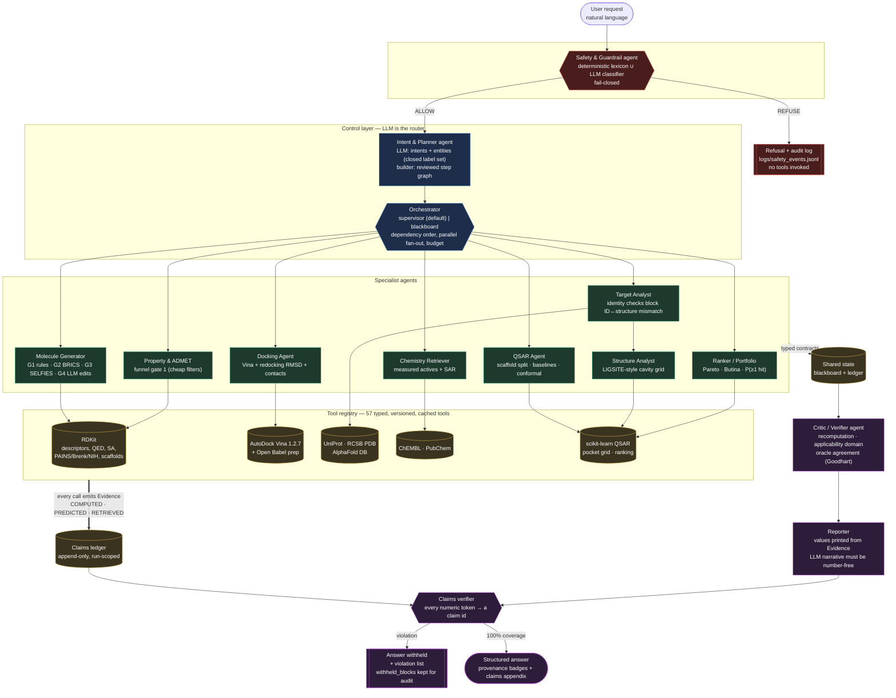

# Architecture

## 1. The one-sentence version

A natural-language request passes a **safety gate**, is routed by an **LLM planner** into a
deterministically expanded step graph, executed by **specialist agents** that may only reach the
outside world through a **typed tool registry**, cross-checked by a **critic**, and rendered by a
**reporter** whose output must pass a **claims verifier** — which refuses to publish any number
that no tool produced.

## 2. Diagram

An exported PNG of this diagram is at `figures/architecture.png`.

## 3. Why this design

### D1 — The ledger is the product, not the agent count
Tool-calling chemistry agents are established work (`docs/sota_audit.md`). What is still missing
in the systems we could verify is a *mechanical* guarantee that a reported number came from a
tool. So the ledger is not a logging convenience: the reporter can only print values by asking an
`Evidence` object to render itself, and the verifier re-scans the finished text and refuses
publication if any numeric token fails to resolve. During development this blocked four of our own
scenarios and each block was a real defect in our reporter — exactly the behaviour we want in
front of a jury.

### D2 — The LLM decides *what*, a reviewed builder decides *how*
The planner LLM returns only: intents (from a closed enum), modality, target tokens, molecule
tokens, objectives. The executable step graph is expanded from those labels by
`planner._steps_for`, which is ordinary reviewed Python. Letting an LLM emit agent or tool names
is the single largest source of broken agent runs, and it also makes tool-order assertions
impossible. With this split the LLM is still the control component — nothing happens until it
classifies the request — but the plan is always executable and always auditable. When no LLM
backend exists, `rule_based_plan` produces the same label set by keyword routing and the run
continues, reporting `planner=rules`.

### D3 — Every oracle carries its own validation
A docking score is reported together with the redocking RMSD of the co-crystal ligand *for the
same prepared receptor* (`validation` field on the Evidence). A QSAR prediction is reported with
its scaffold-split test RMSE, the two baseline RMSEs, a conformal interval and an
applicability-domain verdict. A detected pocket is reported with its distance to the
crystallographic ligand. If a validation could not be run, the Evidence says so and the agent
marks itself `degraded` instead of quoting a bare number.

### D4 — Safety is a gate with a decision table, not a prompt instruction
`agents/safety.py` runs before planning and again on every generated structure. The deterministic
lexicon is the floor: if it fires, the LLM cannot lift the refusal; the LLM may only escalate. If
the classifier is unavailable and the request uses hazard-adjacent vocabulary, the gate refuses
**fail-closed** — this was a real defect found by scenario S10 during development, where the
fallback originally failed open.

### D5 — Two orchestration patterns, chosen by measurement
Both patterns implement the same interface over the same contracts:

| | supervisor (hierarchical) | blackboard (parallel fan-out) |
|---|---|---|
| control | explicit dependency graph from the planner | agents fire when their preconditions appear |
| ordering | guaranteed; tool-order assertions possible | emergent; weaker ordering guarantees |
| failure | dependants are skipped and reported | rounds simply stop producing new facts |
| parallelism | within a dependency level | across all ready agents |

Measured head-to-head on the scenario suite in `docs/evaluation_report.md`. The default is the
supervisor; the blackboard stays in the repo as a measured alternative, which is also the honest
answer to "why this design".

### D6 — Shared state is two objects, not a free-for-all
Agents communicate through (a) the **blackboard** — a lock-protected dict of typed facts
(`target_card`, `actives`, `candidates`, `docking`, `portfolio`) — and (b) the **claims ledger**.
No agent calls another agent directly; no agent holds a reference to another agent's internals.
That is what makes the blackboard pattern a 150-line alternative rather than a rewrite.

### D7 — Degradation is a first-class output
`ctx.degrade(note)` records an honest failure and the note is rendered in its own section of the
answer. Missing data is never filled in: if a target does not resolve, the run reports that and
the dependent steps are explicitly marked "not executed" with the dependency that failed.

## 4. Data flow of one campaign request

1. **Safety gate** → `ALLOW` (logged with the query hash).
2. **Planner** → `intents=[full_campaign]`, `targets=[EGFR]` → 8-step graph.
3. **Target Analyst** → UniProt `P00533` → identity checks → ranked X-ray structures, downloads
   up to four and keeps the first with a drug-like co-crystal ligand → receptor path + ligand
   centroid on the blackboard.
4. **Structure Analyst** → cavity grid → pocket list (+ localisation check against the ligand).
5. **Chemistry Retriever** → ChEMBL target → activities, censored records dropped → `actives`.
6. **Molecule Generator** → four samplers → dedup → **hazard gate** → `candidates`.
7. **Property Agent** → descriptors/alerts/ADMET on every candidate → **funnel gate 1**.
8. **QSAR Agent** → fit on `actives` (scaffold split) → predict on survivors with conformal
   intervals and AD flags.
9. **Docking Agent** → prepare receptor → **redock co-crystal ligand** → dock the top survivors →
   contacts.
10. **Ranker** → Pareto front → Butina clusters → portfolio with P(≥1 hit) bounds.
11. **Critic** → recompute sampled claims with the cache bypassed, audit AD, Spearman between
    oracles.
12. **Reporter → Verifier** → answer or refusal.

## 5. Failure handling

| failure | behaviour |
|---|---|
| tool raises | `ToolResult.ok=False` with the error, agent degrades, run continues |
| network blocked / offline | cached result if present, otherwise explicit failure; never invented |
| LLM unavailable | deterministic fallback per call site (`structured(deterministic=...)`) |
| LLM returns prose instead of the tool schema | JSON block extraction, then the fallback |
| dependency failed | dependants are not executed; each is reported with the dependency that failed |
| time budget exceeded | remaining steps are skipped and listed as skipped |
| identity check failed | structure-based steps are blocked before any docking |
| verifier violation | answer withheld, violations listed, withheld blocks retained for audit |
| hazard hit on a generated structure | structure removed before scoring, event logged |
