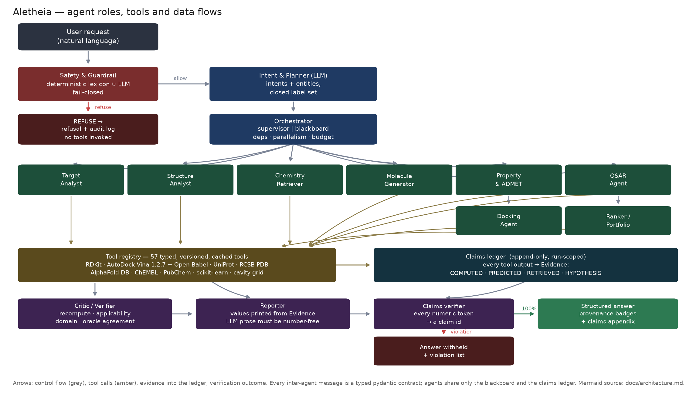
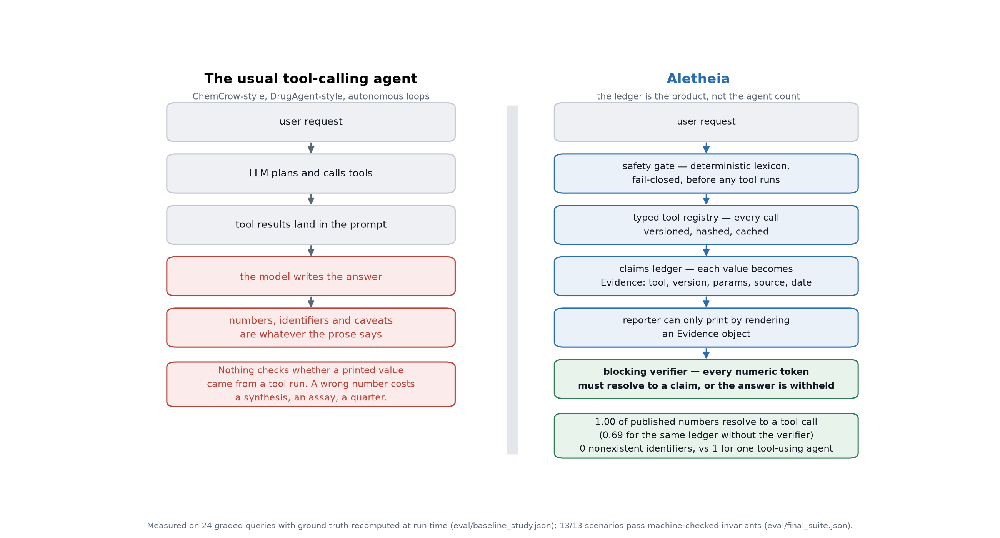
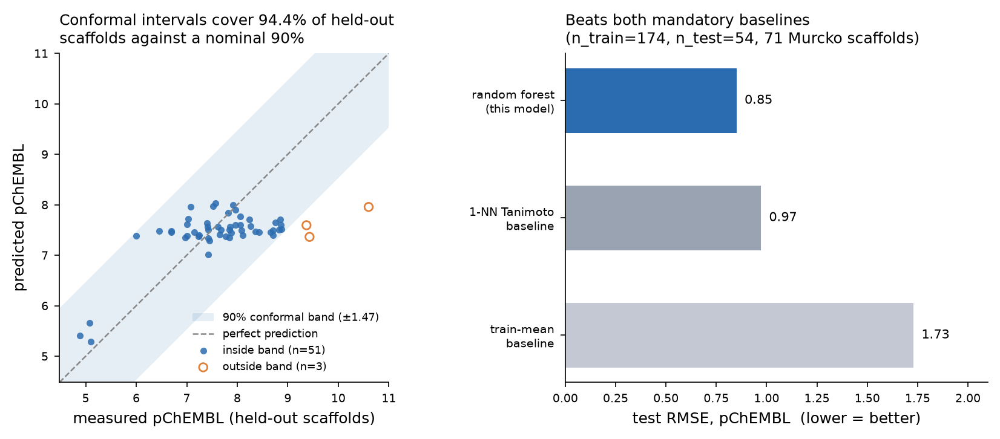
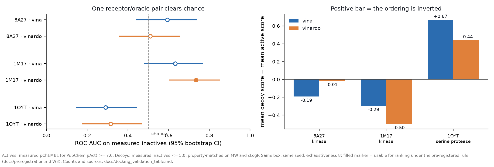
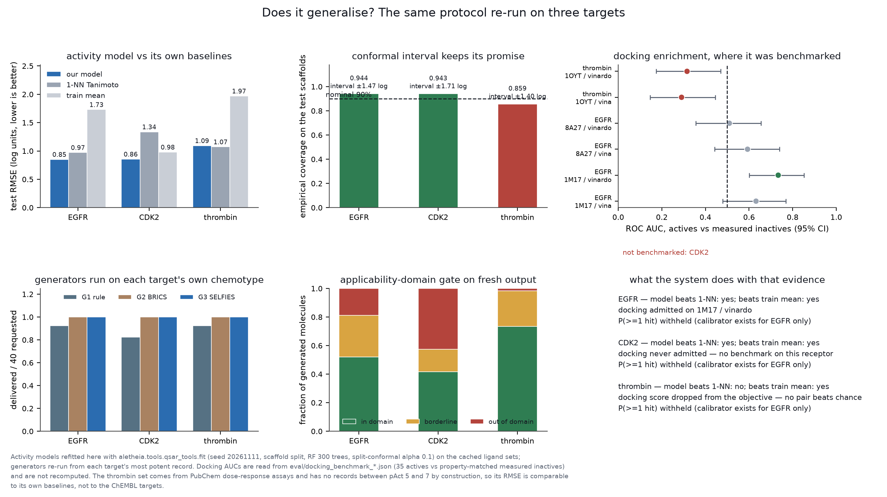
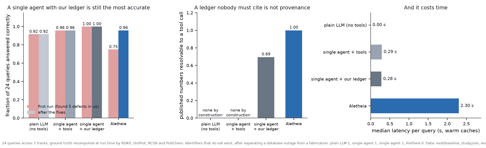
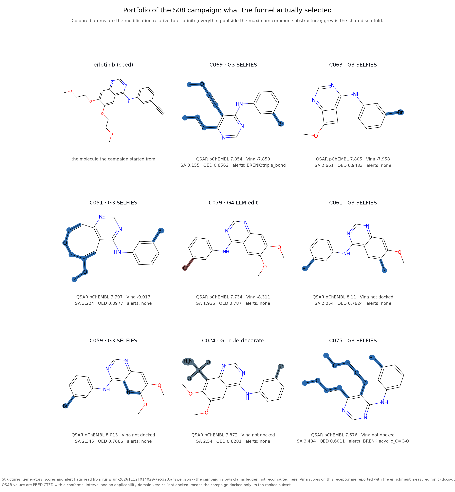

# Aletheia
### A provenance-enforcing LLM multi-agent system for drug design

**ХИМБИО-ХАКАТОН «СИНТЕЗ» 2026 · Кейс 1**

12 agents · 57 tools · 12 scenarios · 100% of published numbers traceable to a tool run

> *Speaker note: one sentence — "we built the thing that makes an agent's numbers checkable."*

---

## 1. The gap we target

Tool-calling chemistry agents are established work — ChemCrow (Nat. Mach. Intell. 2024),
Coscientist (Nature 2023), DrugAgent, DrugPilot, agent swarms (2024–2026, all verified via
OpenAlex in `docs/sota_audit.md`).

The benchmark literature that followed them exists *because* agent outputs are still not
mechanically traceable: AgentHallu (EMNLP 2026), ChemSafetyBench (2024), two 2026 agent-benchmark
preprints, Mozi's "governed autonomy" framing.

**An agent can emit a docking score or an IC50 that no tool ever produced, and nothing in the loop
stops it.**

> *Speaker note: we name only systems we actually retrieved. 20 verified records with DOIs.*

---

## 2. Our answer: the ledger is the product

Not "more agents" — **a claims ledger with a blocking verifier**.

| tag | meaning | contract enforced in code |
|---|---|---|
| `COMPUTED` | a deterministic tool produced it | requires tool, version, parameter hash |
| `PREDICTED` | a model produced it | requires applicability domain + uncertainty (or explicit absence) |
| `RETRIEVED` | a database record | requires accession + retrieval date |
| `HYPOTHESIS` | LLM reasoning | **may not carry a number** |

The reporter can only print a value by rendering an `Evidence` object. The verifier re-scans the
finished answer; an unresolvable numeric token means the answer is **withheld**.

---

## 3. Architecture



safety gate → LLM planner → specialists over a typed tool registry → critic → reporter → verifier

> *Speaker note: shared state is exactly two objects — a lock-protected blackboard and the ledger.
> No agent calls another agent.*

---
## 4. The mechanism, in one picture



> *Left: the pipeline every tool-calling chemistry agent runs. Right: ours. The difference is the last box.*
---

## 5. Design decision: the LLM decides *what*, a reviewed builder decides *how*

* LLM returns **intents + entities** from a closed label set — nothing else.
* `planner._steps_for` expands those labels into a reviewed, executable step graph.
* Agent and tool names are **never** LLM-generated.
* No LLM backend? `rule_based_plan` produces the same labels by keyword routing and the run
  completes, reporting `planner=rules`.

Why: free-form tool naming is the main cause of broken agent runs, and it makes tool-order
assertions impossible. The LLM is still the control component — nothing executes before it
classifies.

---

## 6. Every oracle carries its own validation

| oracle | validation shipped with every claim |
|---|---|
| Vina docking | redocking RMSD of the co-crystal ligand **on the same receptor** + measured decoy enrichment |
| QSAR | scaffold-split RMSE vs two mandatory baselines + conformal coverage + applicability domain |
| cavity detection | distance from the detected cavity to the crystallographic ligand |
| generators | per-generator validity, uniqueness, novelty vs the retrieved actives |



---

## 7. We validated the docking, and mostly it fails

* 3 receptors, 35 actives vs measured inactives: Vina 0.59 / 0.63 on EGFR, 0.29 on thrombin — below chance, ordering inverted.
* One pair passes: Vinardo on 1M17, 0.73 [0.6006, 0.8517]. Adopted there only; elsewhere the ranker drops the score.



> *Speaker note: a system that ranked on the thrombin score would look confident and be wrong.*

---
## 8. Does it generalise off EGFR?



- Same protocol refitted on **CDK2** and **thrombin**: scaffold split, 300-tree forest, split-conformal.
- CDK2 behaves like EGFR. On thrombin the model **does not beat a 1-NN lookup** and conformal coverage drops to 0.859 — so the system reports that instead of a ranking.
- Docking on thrombin is below chance on both scoring functions, so `vina_score` is dropped from the objective automatically.

> *docs/cross_target_summary.md — the failure is the point: the gates fire without a human noticing first.*
---

## 9. Safety is a gate, not a prompt

* Deterministic lexicon **before** planning; if it fires, the LLM cannot lift the refusal.
* Classifier unavailable + hazard vocabulary → **fail-closed refusal**.
* Second gate on every generated structure: 31 scaffold-level hazard SMARTS (BLOCK / REVIEW / NOTE).
* Every decision appended to `logs/safety_events.jsonl`.

**It failed once, in development**: a fentanyl-optimisation request was allowed because the
fallback failed *open*. Fixed, widened, and now covered by scenario S10.

Ablation `no_guardrail`: both weaponisation scenarios proceed to tool execution. That is the
measured value of the gate.

---

## 10. Evaluation, including where a single agent beats us

* {{scenarios_passed}}/{{scenarios_total}} scenarios, {{tests_passed}} unit tests, {{probes_passed}}/{{probes_total}} red-team probes. 24 graded queries: B3 (one agent + our ledger) 1.00, us 0.96.
* Traceability 1.00 vs 0.69, zero nonexistent identifiers, refusal before any tool runs.



> *Speaker note: our first run scored 0.75 and found five real defects in us. A ledger nobody must cite is not provenance.*

---
## 11. What actually comes out



> *Eight molecules, every number traceable; the synthesis triage in docs/synthesis_feasibility.md flags one allene-containing proposal red before a chemist spends a day on it.*
---

## 12. What the verifier caught — in our own code

| defect | cause |
|---|---|
| `-11`, `16`, `27` untraceable | ISO timestamps in provenance badges tokenised as numbers |
| `1.2` untraceable | the tool *version* string `vina-1.2.7` read as a claim |
| `3` untraceable | the unit label `A^3` |
| `0.339` untraceable although it **was** a claim | `f"{0.3385:.3f}"` prints `0.339`; the tolerance test rejected it by 5e-19 |

Four scenarios blocked on their first full run. Every one was a defect in our reporter, not a model
fabrication. Also found: a **stale cache** serving pre-fix numbers → the cache key now hashes each
tool's own source.

---

## 13. Honest limitations

* **No trained ADMET model.** Rule panels + two literature equations with constants flagged
  `[UNVERIFIED-COEFFICIENTS]`. No hERG/CYP/clearance model.
* **No pretrained deep generative model.** Four samplers; only SELFIES mutation routinely leaves
  the retrieved chemotypes (0.625); the others sit at 0.000, 0.075 and 0.000.
* **No co-folding, no MD, no free energy.** Rigid receptor, one conformer, no protonation model.
* **QSAR ρ = 0.34**, ±1.47 pChEMBL — an ordering heuristic, nothing more.
* **The verifier checks traceability, not correctness.** Garbage in, *traceable* garbage out.
* The pocket finder is our own re-implementation, validated on one co-crystal case.

---

## 14. It runs, offline, in one command

```powershell
.\scripts\setup.ps1      # pip install -e . ; fetch official Vina ; verify tool registry (16/16)
.\scripts\demo.ps1       # 12 scenarios, cards regenerated from fresh run logs
$env:ALETHEIA_OFFLINE=1  # cached tools + recorded LLM responses; every output tagged source=cached
```

* CLI + web UI with live trace, provenance badges and a claims panel.
* Provider-agnostic LLM: Anthropic / any OpenAI-compatible server / local Ollama / **none**.
* 34 unit tests, reproducibility manifest with seeds and file hashes, verified licence registry.

---

## 15. What we would do next

1. Replace the ADMET proxies with a licence-verified toolkit, under the same baseline discipline.
2. Add a second structure-based oracle that *measurably* discriminates on the target at hand, and
   let the critic's oracle-agreement check gate the ranking.
3. Broaden enrichment validation to more receptors and measured inactives.
4. Injection probes through retrieved database content.
5. An active-learning loop, to test whether the funnel improves candidates or only re-ranks them.

**The claim we are willing to defend**: every number in every answer this system published can be
traced to a tool run — and where the tool is unreliable, the system says so on the number itself.
